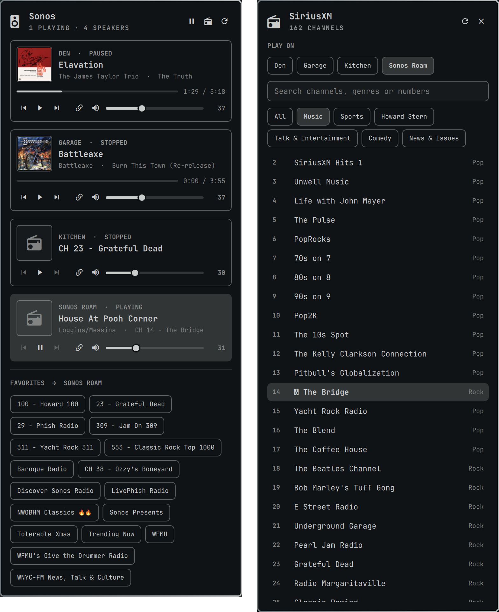

# Sonos for the Omarchy bar

Control your Sonos speakers from the Omarchy bar. A pill shows what's
playing; click it for a popup with every room:

<p align="center"></p>

- album art, track, progress, play/pause/skip
- group volume and per-speaker volume when grouped
- grouping: link and unlink speakers into any number of groups
- your Sonos favorites, one click to play on the selected room
- a SiriusXM channel picker: browse or search every channel and play it

Everything talks to the speakers directly on your local network through
[SoCo](https://github.com/SoCo/SoCo). No Sonos cloud account is used.

## Install

```bash
omarchy plugin add https://github.com/tskyrm/omarchy-sonos.git --enable
```

On first run the widget creates a private Python environment in
`~/.local/share/omarchy-sonos/venv` and installs SoCo into it (the panel
shows "First run: installing SoCo…" for a few seconds). It needs `python3`,
which Omarchy ships, and internet access for that one-time install.

Update with `omarchy plugin update tskyrm.sonos`; remove with
`omarchy plugin remove tskyrm.sonos` (then optionally
`rm -rf ~/.local/share/omarchy-sonos ~/.cache/omarchy-sonos`).

## Bar

- left click: popup
- middle click: play/pause
- scroll: volume

The bar follows whichever room is playing. To pin it to one room:
`omarchy bar set tskyrm.sonos room "Living Room"`

Other settings (`omarchy bar set tskyrm.sonos <key> <value>`): `showLabel`,
`maxLabelWidth`, `volumeStep`, `python` (a python that can import soco, to
skip the private venv).

## Popup

Click a room card to select it; favorites and SiriusXM play on the
selected room.

Keys: `j/k` or arrows select a room · `space`/`p` play/pause · `n` next ·
`b` previous · `+`/`-` volume · `m` mute · `s` SiriusXM · `r` rescan ·
`Esc` close

## Grouping

Each card has a 󰌹 button that shows speaker chips for that room: ✓ chips
are in its group (tap to send back to their own room), + chips are not
(tap to pull in; a speaker grouped elsewhere moves over). Several groups
can exist at once: open 󰌹 on one room and add a speaker, then do the same
on another.

## SiriusXM

The 󰐹 button (or `s`) lists every SiriusXM channel, filterable by category
or searchable by name, genre or number. Pick a room under PLAY ON, then
click a channel; the room's current channel is marked. Enter plays the top
search result; Esc clears the search, then goes back.

Requirements and caveats:

- SiriusXM must be set up in the Sonos app, and **at least one SiriusXM
  channel must be saved as a Sonos favorite**. SiriusXM doesn't allow
  third-party apps to link to it, so playback reuses the account reference
  from that favorite; your speaker supplies the actual login.
- The channel list comes from the public
  [siriusxm.com/channels](https://www.siriusxm.com/channels) page, cached
  for a week (󰑐 in the SiriusXM view refetches). If SiriusXM redesigns
  that page the list may stop loading until the plugin is updated;
  favorites keep working regardless.

## IPC

```bash
omarchy-shell sonos playpause|next|previous|volumeUp|volumeDown|pauseAll|toggle|siriusxm
```

Handy for Hyprland keybindings.

## How it works

`bin/launch` starts `bin/sonos-bar`, a small SoCo daemon that speaks
line-delimited JSON with the widget over stdin/stdout. Speakers are found
with a unicast subnet scan, because Omarchy's default firewall (ufw) drops
the replies to Sonos's multicast discovery and blocks its push events.
Their IPs are cached in `~/.cache/omarchy-sonos/speakers.json`, and the
speakers are polled every 2s while the popup is open, 6s otherwise.

Nothing leaves your network except the one-time SoCo install from PyPI
and the SiriusXM channel list from siriusxm.com.

## Troubleshooting

- **"No Sonos speakers found"**: the computer must be on the same network
  (and subnet) as the speakers. Press 󰑐 in the popup to rescan.
- **Commands not responding after editing plugin files**: hot reloads keep
  the first-loaded IPC handler; run `omarchy restart shell`.
- **Setup failed**: check `journalctl --user -u omarchy-shell`, then
  `rm -rf ~/.local/share/omarchy-sonos` and `omarchy restart shell` to
  retry.

## License

MIT
